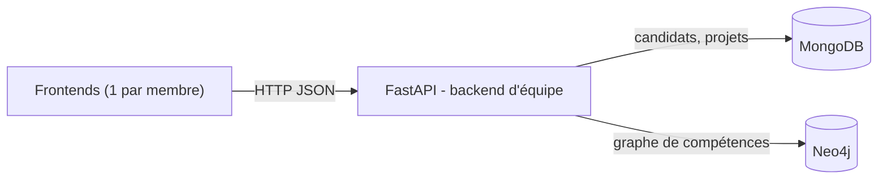
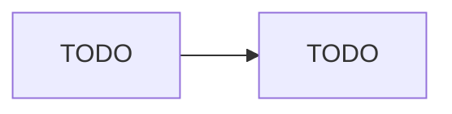

# 🧠 ARCHITECTURE - Équipe `TODO-nom-equipe`

> **Jalon 1** : ce document est votre **spécification**. Il doit être **complet** : toute l'équipe va coder dessus.
> Toutes les sections sont obligatoires. Remplacez **tous** les `TODO` (la CI « Livrables » les compte).
> En soutenance (5 à 6 min), vous présenterez surtout la **section 1** (schéma) et le contrat `API_ROUTES.md`.

## 1. Schéma d'architecture

Montrez **qui stocke quoi** et **quels flux** : frontends → API → MongoDB / Neo4j.

**Recommandé : [Excalidraw](https://excalidraw.com)** (à plusieurs via *Live collaboration*). Exportez en PNG ou SVG avec **« Embed scene »** coché,
enregistrez dans `docs/architecture.excalidraw.png`, puis remplacez le schéma Mermaid ci-dessous par :

``

L'image reste modifiable : rouvrez-la dans Excalidraw (ou dans VS Code avec l'extension *Excalidraw*).



TODO : en 3 à 5 lignes, le rôle de chaque base dans votre portfolio.

## 2. Les requêtes à servir

| # | Besoin (vu par un recruteur) | Route API | Base(s) interrogée(s) |
|---|---|---|---|
| R1 | Profil + timeline (expériences, formations) d'un candidat | `GET /api/candidats/{slug}` | TODO |
| R2 | Projets d'un candidat, filtrables par compétence | `GET /api/candidats/{slug}/projets` | TODO |
| R3 | Statistiques d'un candidat par compétence | `GET /api/candidats/{slug}/stats` | TODO |
| R4 | Projets similaires à un projet | `GET /api/graph/projets/{slug}/similaires` | TODO |
| R5 | Graphe de compétences d'un candidat | `GET /api/graph/competences/{slug}` | TODO |
| TODO | Vos requêtes supplémentaires | TODO | TODO |

## 3. Modèle MongoDB

### 3.1 Collection `candidats` - pattern TODO (*Embedding* ? *Referencing* ?)

```json
TODO : un document d'exemple complet
```

**Justification** (cardinalité bornée ou non, lecture en une requête, fréquence de mise à jour) : TODO

### 3.2 Collection `projets` - pattern TODO

```json
TODO : un document d'exemple complet
```

**Justification** : TODO

### 3.3 Index

| Collection | Index | Requête servie (R#) |
|---|---|---|
| TODO | TODO | TODO |

### 3.4 Pipeline d'agrégation clé (R3)

```javascript
TODO : db.projets.aggregate([ ... ])
```

## 4. Modèle Neo4j

### 4.1 Schéma du graphe



| Label | Propriétés | Clé unique |
|---|---|---|
| TODO | TODO | TODO |

| Relation | De → Vers | Propriétés | Pourquoi ce sens |
|---|---|---|---|
| TODO | TODO | TODO | TODO |

### 4.2 Les 3 requêtes Cypher clés

```cypher
// R4 - projets similaires
TODO

// R5 - graphe de compétences d'un candidat
TODO

// Compétences communes aux membres de l'équipe (ou requête de votre choix)
TODO
```

### 4.3 Contraintes

```cypher
TODO : CREATE CONSTRAINT ... IF NOT EXISTS
```

## 5. Cohérence entre les bases (slugs pivots)

| Entité | Slug | Dans MongoDB | Dans Neo4j |
|---|---|---|---|
| Candidat | `candidat_slug` (ex. `alice-martin`) | TODO | TODO |
| Projet | `projet_slug` (ex. `smartcity-explorer`) | TODO | TODO |
| Compétence | `skill_slug` (ex. `mongodb`) | TODO | TODO |

**Suppression d'un projet** : que faites-vous dans chaque base ? TODO

## 6. Répartition du travail

| Membre (pseudo GitHub) | Backend (couches / routes) | Frontend |
|---|---|---|
| TODO | TODO | `frontends/frontend-TODO/` |
