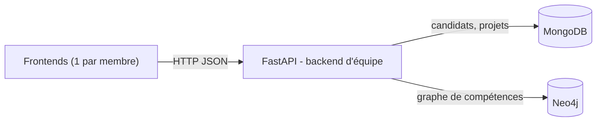
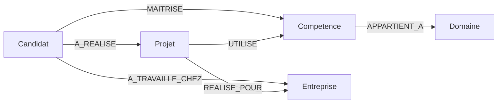

# 🧠 ARCHITECTURE - Équipe `NoSqlteam`

> **Jalon 1** : ce document est votre **spécification**. Il doit être **complet** : toute l'équipe va coder dessus.
> Toutes les sections sont obligatoires. Remplacez **tous** les `TODO` (la CI « Livrables » les compte).
> En soutenance (5 à 6 min), vous présenterez surtout la **section 1** (schéma) et le contrat `API_ROUTES.md`.

## 1. Schéma d'architecture

Montrez **qui stocke quoi** et **quels flux** : frontends → API → MongoDB / Neo4j.

**Recommandé : [Excalidraw](https://excalidraw.com)** (à plusieurs via *Live collaboration*). Exportez en PNG ou SVG avec **« Embed scene »** coché,
enregistrez dans `docs/architecture.excalidraw.png`, puis remplacez le schéma Mermaid ci-dessous par :

``
L'image reste modifiable : rouvrez-la dans Excalidraw (ou dans VS Code avec l'extension *Excalidraw*).


### Roles des bases :
- MongoDB : stocke les données structurées du portfolio (profils des candidats, formations, expériences professionnelles et projets réalisés)
- Neo4j : stocke les relations entre les candidats, leurs compétences, leurs projets, les domaines d'expertise. Elle permet d'explorer le graphe 
	  de compétences et d'identifier les liens entre les différentes entités.
 
MVP (6 entités utiles à garder ) :
- Candidat 
- Formations
- Expériences
- Compétentes
- Domaines de compétences
- Projet
## 2. Les requêtes à servir

| # | Besoin (vu par un recruteur) | Route API | Base(s) interrogée(s) |
|---|---|---|---|
| R1 | Profil + timeline (expériences, formations) d'un candidat | `GET /api/candidats/{slug}` |MongoDB candidats|
| R2 | Projets d'un candidat, filtrables par compétence | `GET /api/candidats/{slug}/projets` | MongoDB projets |
| R3 | Statistiques d'un candidat par compétence | `GET /api/candidats/{slug}/stats` | Agrégation MongoDB, enrichie par competences|
| R4 | Projets similaires à un projet | `GET /api/graph/projets/{slug}/similaires` | Neo4j |
| R5 | Graphe de compétences d'un candidat | `GET /api/graph/competences/{slug}` | Neo4j |
| R6 | Consulter le détail d'un projet (description, technologies utilisées, résultats, lien GitHub) |`GET /api/projets/{slug}` |MongoDB + Neo4j |
| R7 | Quelle est l’expérience professionnelle la plus récente du candidat ? |`GET /api/candidats/{slug}/experiences/recente`| MongoDB candidats |
| R8 | Quels projets du candidat démontrent ses compétences dans un domaine donné ? |`GET /api/candidats/{slug}/projets?domaine_slug=data`|MongoDB projets (filtre domaine_slugs)|

## 3. Modèle MongoDB

### 3.1 Collection `candidats` - pattern TODO (*Embedding* ? *Referencing* ?)


# un document d'exemple complet
```json
{
  "slug": "alice-martin",
  "nom": "Martin",
  "prenom": "Alice",
  "titre": "Eleve ingenieure Big Data",
  "description": "Passionné par la data science et l'ia",
  "contact": {
    "email": "alice@example.com",
    "telephone": "84775757575"
  },
  "liens": {
    "github": "https://github.com/alice-martin",
    "linkdIn": "https://linkdIn.com/alice-martin"
  },
  "formations": [
    {
      "etablissement": "ESIGELEC",
      "diplome": "Diplome d'ingenieur",
      "date_debut": "2024-09",
      "date_fin": "2027-06"
    }
  ],
  "experiences": [
    {
      "poste": "Stagiaire Data Engineer",
      "entreprise": "Entreprise Exemple",
      "date_debut": "2026-06",
      "date_fin": "2026-08"
    }
  ],
  "competences": [
    {
      "slug": "python",
      "nom": "Python",
      "type": "technique",
      "domaine_slug": "programmation",
      "niveau": "intermediaire"
    },
    {
      "slug": "mongodb",
      "nom": "MongoDB",
      "type": "technique",
      "domaine_slug": "data-engineering",
      "niveau": "intermediaire"
    },
    {
      "slug": "anglais",
      "nom": "Anglais",
      "type": "linguistique",
      "domaine_slug": "langues",
      "niveau": "B2"
    },
    {
      "slug": "travail-equipe",
      "nom": "Travail en equipe",
      "type": "transversale",
      "domaine_slug": "soft-skills",
      "niveau": null
    }
  ]
}
```

**Justification** (cardinalité bornée ou non, lecture en une requête, fréquence de mise à jour) :

### 3.2 Collection `projets` - pattern TODO

```json

{
  "slug": "smartcity-explorer",
  "titre": "SmartCity Explorer",
  "description": "Application d'exploration et d'analyse de donnees urbaines",
  "contexte": "Projet academique NoSQL",
  "architecture": "FastAPI, MongoDB et Neo4j",
  "date_debut": "2026-09",
  "date_fin": "2026-11",
  "candidat_slugs": [
    "alice-martin",
    "bob-dupont"
  ],
  "competence_slugs": [
    "python",
    "mongodb",
    "neo4j"
  ],
  "domaine_slugs": [
    "programmation",
    "data-engineering"
  ],
  "technologies": [
    "Python",
    "FastAPI",
    "MongoDB",
    "Neo4j"
  ],
  "réalisation": [
    "Developpement d'une API REST",
    "Integration de plusieurs bases de donnees",
    "Visualisation et exploration de donnees"
  ],
  "liens": {
    "github": "https://github.com/exemple/smartcity-explorer",
    "demo": null
  },
  "medias": [
    {
      "type": "image",
      "url": "https://example.com/smartcity.png",
      "description": "Capture d'ecran de l'application"
    }
  ]
}

```

**Justification** : TODO

### 3.3 Index

| Collection | Index | Requête servie (R#) |
|---|---|---|
| candidats | 	{ slug: 1 } (unique) | 	R1, R7 |
| projets | { slug: 1 } (unique) | R6 |
| projets | { candidat_slugs: 1 } | R2, R3, R8 |
| projets | { competence_slugs: 1 } | R2 |
| projets | { domaine_slugs: 1 } | R8 |
### 3.4 Pipeline d'agrégation clé (R3)

```javascript
TODO : db.projets.aggregate([ ... ])

db.projets.aggregate([
  // 1. Filtrer les projets du candidat
  {
    $match: {
      candidat_slugs: "alice-martin"
    }
  },

  // 2. Décomposer le tableau des compétences
  {
    $unwind: "$competence_slugs"
  },

  // 3. Regrouper par compétence et compter les projets
  {
    $group: {
      _id: "$competence_slugs",
      nombre_projets: { $sum: 1 }
    }
  },

  // 4. Trier par nombre de projets décroissant
  {
    $sort: {
      nombre_projets: -1
    }
  },

  // 5. Formater le résultat
  {
    $project: {
      _id: 0,
      competence_slug: "$_id",
      nombre_projets: 1
    }
  }
]);
```

## 4. Modèle Neo4j

### 4.1 Schéma du graphe

```mermaid
graph LR
    %% TODO : vos nœuds et relations orientées, ex. (Candidat)-[:A_REALISE]->(Projet)-[:UTILISE]->(Competence)-[:APPARTIENT_A]->(Domaine)
```




| Label | Propriétés | Clé unique |
|---|---|---|
| Candidat | slug, nom, prenom, titre | slug |
| Projet | slug, titre | slug |
| Competence | slug, nom, type | slug |
| Domaine | slug, nom | slug |
| Entreprise | slug, nom | slug |

| Relation | De → Vers | Propriétés | Pourquoi ce sens |
|---|---|---|---|
| A_REALISE | Candidat → Projet | role, date_participation | Un candidat réalise un ou plusieurs projets. |
| MAITRISE | Candidat → Competence | niveau | 	Un candidat possède une compétence avec un niveau de maîtrise. |
| A_TRAVAILLE_CHEZ | Candidat → Entreprise | poste, date_debut, date_fin | Un candidat travaille ou a travaillé dans une entreprise. |
| UTILISE | Projet → Competence | importance (optionnel) | Un projet mobilise une ou plusieurs compétences techniques. |
| APPARTIENT_A | Competence → Domaine | Aucune | Une compétence est classée dans un domaine. |
| REALISE_POUR | Projet → Entreprise | contexte (optionnel) | Un projet peut être réalisé pour une entreprise. |

### 4.2 Les 3 requêtes Cypher clés

```cypher

 // R4 - Projets similaires
 // Retrouver les projets partageant des compétences

MATCH (p:Projet {slug: $projet_slug})-[:UTILISE]->(c:Competence)<-[:UTILISE]-(similaire:Projet)
WHERE p <> similaire
RETURN
    similaire.slug AS projet_slug,
    similaire.titre AS titre,
    count(DISTINCT c) AS nombre_competences_communes,
    collect(DISTINCT c.nom) AS competences_communes
ORDER BY nombre_competences_communes DESC
LIMIT 5;


// R5 - Graphe de compétences d'un candidat
// Retourner les noeuds et relations pour le frontend

MATCH (c:Candidat {slug: $candidat_slug})
OPTIONAL MATCH (c)-[r1:MAITRISE]->(comp:Competence)
OPTIONAL MATCH (comp)-[r2:APPARTIENT_A]->(dom:Domaine)
OPTIONAL MATCH (c)-[r3:A_REALISE]->(p:Projet)
OPTIONAL MATCH (p)-[r4:UTILISE]->(cp:Competence)
OPTIONAL MATCH (cp)-[r5:APPARTIENT_A]->(dp:Domaine)

WITH
    [c] + collect(DISTINCT comp)
        + collect(DISTINCT dom)
        + collect(DISTINCT p)
        + collect(DISTINCT cp)
        + collect(DISTINCT dp) AS noeudsBruts,
    collect(DISTINCT r1)
        + collect(DISTINCT r2)
        + collect(DISTINCT r3)
        + collect(DISTINCT r4)
        + collect(DISTINCT r5) AS relationsBrutes

WITH
    reduce(acc = [], n IN noeudsBruts |
        CASE WHEN n IS NULL OR n IN acc
        THEN acc ELSE acc + [n] END) AS noeuds,
    reduce(acc = [], r IN relationsBrutes |
        CASE WHEN r IS NULL OR r IN acc
        THEN acc ELSE acc + [r] END) AS relations

RETURN
    [n IN noeuds | {
        id: labels(n)[0] + ":" + n.slug,
        label: coalesce(n.nom, n.titre, n.slug),
        type: labels(n)[0]
    }] AS nodes,
    [r IN relations | {
        source: labels(startNode(r))[0] + ":" + startNode(r).slug,
        target: labels(endNode(r))[0] + ":" + endNode(r).slug,
        type: type(r)
    }] AS links;


// Compétences communes aux membres de l'équipe
// Identifier les compétences partagées par deux candidats

MATCH (c1:Candidat)-[:MAITRISE]->(comp:Competence)<-[:MAITRISE]-(c2:Candidat)
WHERE c1.slug < c2.slug
  AND c1.slug IN $slugs_equipe
  AND c2.slug IN $slugs_equipe

RETURN
    c1.slug AS candidat_1,
    c2.slug AS candidat_2,
    count(DISTINCT comp) AS nombre_competences_communes,
    collect(DISTINCT comp.nom) AS competences_communes
ORDER BY nombre_competences_communes DESC;

```
### 4.3 Contraintes

```cypher


CREATE CONSTRAINT candidat_slug_unique IF NOT EXISTS
FOR (c:Candidat)
REQUIRE c.slug IS UNIQUE;

CREATE CONSTRAINT projet_slug_unique IF NOT EXISTS
FOR (p:Projet)
REQUIRE p.slug IS UNIQUE;

CREATE CONSTRAINT competence_slug_unique IF NOT EXISTS
FOR (c:Competence)
REQUIRE c.slug IS UNIQUE;

CREATE CONSTRAINT domaine_slug_unique IF NOT EXISTS
FOR (d:Domaine)
REQUIRE d.slug IS UNIQUE;

CREATE CONSTRAINT entreprise_slug_unique IF NOT EXISTS
FOR (e:Entreprise)
REQUIRE e.slug IS UNIQUE;


```

## 5. Cohérence entre les bases (slugs pivots)

| Entité | Slug | Dans MongoDB | Dans Neo4j |
|---|---|---|---|
| Candidat | `candidat_slug` (ex. `alice-martin`) | candidats.slug et projets.candidat_slugs[] | (:Candidat {slug: "alice-martin"}) |
| Projet | `projet_slug` (ex. `smartcity-explorer`) | projets.slug | (:Projet {slug: "smartcity-explorer"}) |
| Compétence | `skill_slug` (ex. `mongodb`) | candidats.competences[].slug et projets.competence_slugs[] | (:Competence {slug: "mongodb"}) |

**Suppression d'un projet** : que faites-vous dans chaque base ? TODO
Les slugs pivots permettent d'identifier une même entité dans MongoDB et Neo4j sans utiliser les identifiants internes (_id MongoDB ou identifiants Neo4j).
- MongoDB stocke les informations détaillées des candidats et des projets.
- Neo4j stocke les nœuds et les relations entre candidats, projets, compétences et domaines.
- FastAPI utilise les slugs communs pour retrouver et assembler les informations issues des deux bases. 
## 6. Répartition du travail

| Membre (pseudo GitHub) | Backend (couches / routes) | Frontend |
|---|---|---|
| HE020215 | MongoDB candidats : modèles Pydantic, repository, services et routes R1, R7 | frontends/frontend-HE020215/ |
| Loiclr12 | MongoDB projets : modèles Pydantic, repository, filtres et routes R2, R6, R8 |frontends/frontend-Loiclr12/|
| Tahirou111 | Neo4j : modèles du graphe, repository Cypher, relations et routes R4, R5 | frontends/frontend-Tahirou111/ |
| ZHONXucan | Agrégations MongoDB R3, intégration FastAPI, orchestration MongoDB/Neo4j, script seed.py et tests | frontends/frontend-ZHONXucan/ |

